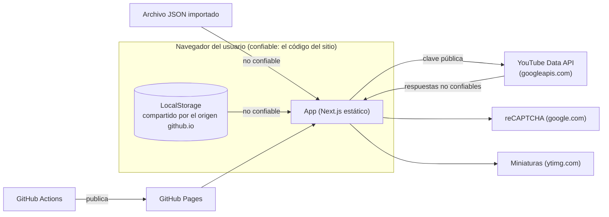

# Modelo de amenazas

Última revisión: 2026-10-11. Actualízalo cuando cambie la arquitectura (un
backend, un proveedor nuevo, otro tipo de dato guardado) o cuando se agregue
un dominio a la CSP.

## Qué se protege

| Activo | Por qué importa |
| --- | --- |
| Cuota diaria de la YouTube Data API | Es compartida: si se agota, la herramienta deja de funcionar para todos hasta el reinicio. |
| Integridad del sitio publicado | Un script inyectado se ejecutaría en el navegador de cada visitante. |
| Clave de la API y su proyecto de Google Cloud | Una clave sin restricciones permite usar otras APIs del proyecto. |
| Privacidad de quien usa el sitio | Las playlists que consulta solo deberían quedar en su navegador. |
| Datos del navegador (LocalStorage) | El historial y los títulos recuperados no se pueden obtener de otra forma. |

## Límites de confianza

Todo lo que entra a la aplicación se trata como no confiable: respuestas de
la API (títulos y descripciones los escriben terceros), archivos importados y
LocalStorage, que comparten todos los sitios de
`herramientaswebsencillas.github.io`.

## Amenazas y mitigaciones

| Amenaza | Vector | Mitigación actual | Riesgo residual |
| --- | --- | --- | --- |
| XSS por datos externos | Título o URL maliciosos en la API, en un JSON importado o en LocalStorage | React escapa el texto; `href`/`src` pasan por `safeYouTubeUrl` (lista de hosts); sin `dangerouslySetInnerHTML`; CSP ([ADR 0003](adr/0003-csp-en-meta.md)) | La CSP permite `'unsafe-inline'` en scripts. |
| Agotar la cuota | Script que usa la clave extraída del bundle | Restricción por referente y límites de cuota en Google Cloud; reCAPTCHA en la interfaz ([ADR 0002](adr/0002-recaptcha-sin-servidor.md)) | El referente se puede falsificar fuera del navegador y el reCAPTCHA no se verifica (revisión pendiente en el ADR 0002). |
| Abuso de la clave en otras APIs | Clave sin restricción de API | Restricción a la YouTube Data API (README); rotación documentada | Depende de la configuración de Google Cloud, que no está en el repositorio. |
| Datos locales manipulados | Otro sitio del mismo origen o una extensión escribe en LocalStorage | `toAnalysisResult` reconstruye y valida todo; las claves derivadas se recalculan; el ID de playlist se valida antes de usarlo como clave | Un dato manipulado puede mostrar títulos falsos, sin ejecutar código. |
| Archivo de importación enorme o malformado | Archivo de varios GB o JSON inválido | Límite de 20 MB; errores legibles; límite de errores en la UI | — |
| Compromiso de la cadena de suministro | Dependencia o acción de CI maliciosa | Versiones exactas y `npm ci`; acciones fijadas por SHA; `npm audit` en CI; CodeQL; Dependabot; SBOM por despliegue | Las excepciones aceptadas están en `SECURITY.md`. |
| Publicación de código no revisado | Push directo a `main` | Ruleset que exige PR y el check `verify` | Con un solo mantenedor no hay revisión de otra persona. |
| Rastreo de terceros | reCAPTCHA y miniaturas de YouTube | Declarados en el aviso de privacidad; sin analítica propia; fuentes servidas desde el propio sitio | reCAPTCHA recoge datos del dispositivo. |
